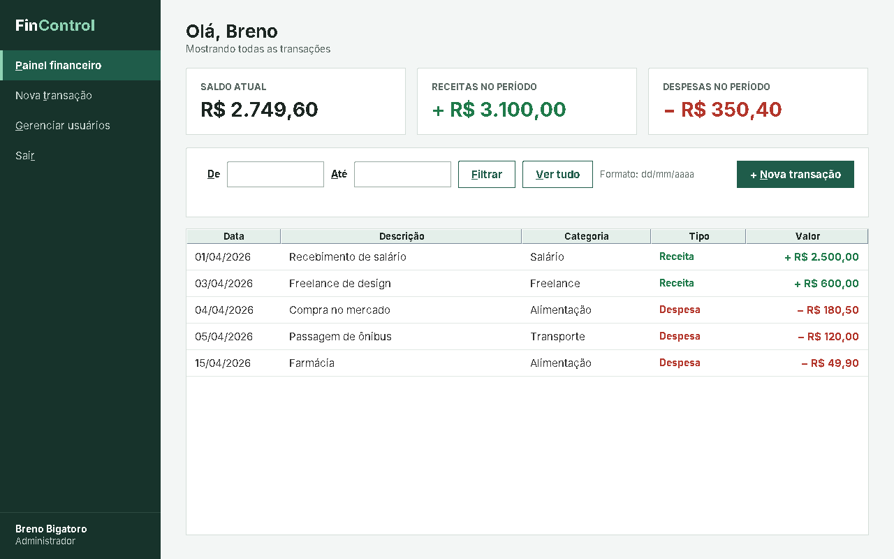
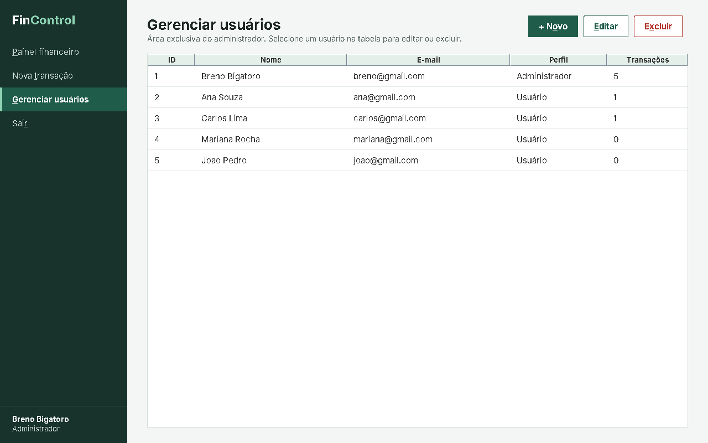

# FinControl — Sistema de Controle Financeiro Pessoal


Projeto Integrador do curso de Desenvolvimento de Sistemas — SENAC.

Repositório: [FinControl no GitHub](https://github.com/brenobigatoro-max/https-github.com-SEU-USUARIO-fincontrol).

## Status do projeto

🚧 **Em desenvolvimento**

| Etapa | Entrega | Situação |
|---|---|---|
| 1 | Documento de requisitos e diagrama de classes (UML) | Concluída |
| 2 | Projeto de interfaces (UX/UI) no Figma | Concluída |
| 3 | Telas em Java Swing com dados simulados | Concluída |
| 4 | Integração com o banco de dados MySQL | Concluída |
| 5 | Versionamento no GitHub | Repositório publicado |

## Objetivo do software

O FinControl é um sistema desktop que ajuda as pessoas a organizar a vida financeira de forma simples. Muita gente tem dificuldade para controlar os gastos do mês, o que pode levar à desorganização e ao endividamento.

O sistema substitui as anotações em papel e as planilhas. Nele o usuário:

- registra receitas e despesas, separadas por categoria;
- vê o saldo atualizado automaticamente;
- consulta as movimentações de um período.

Há dois perfis:

- **Usuário comum:** controla as próprias finanças e vê apenas os próprios dados.
- **Administrador:** faz o mesmo que o usuário comum e também gerencia os usuários do sistema.

## Funcionalidades do sistema (requisitos)

### Requisitos funcionais

| Código | Funcionalidade | Descrição | Situação |
|---|---|---|---|
| RF001 | Cadastro de usuário | Novos usuários se cadastram informando nome, e-mail e senha | ✅ Implementado |
| RF002 | Login no sistema | Autenticação por e-mail e senha | ✅ Implementado |
| RF003 | Cadastro de receitas | Registrar entradas com descrição, valor, data e categoria | ✅ Implementado |
| RF004 | Cadastro de despesas | Registrar saídas com descrição, valor, data e categoria | ✅ Implementado |
| RF005 | Consulta de saldo | Saldo calculado automaticamente com base nas transações | ✅ Implementado |
| RF006 | Listagem de transações | Visualizar todas as movimentações do usuário | ✅ Implementado |
| RF007 | Filtro por período | Filtrar as transações por data inicial e final | ✅ Implementado |
| RF008 | Gerenciamento de usuários | O administrador cadastra, edita e exclui usuários | ✅ Implementado |

### Requisitos não funcionais

| Código | Requisito | Descrição | Situação |
|---|---|---|---|
| RNF001 | Segurança de dados | As senhas são armazenadas como hash SHA-256 | ✅ Implementado |
| RNF002 | Usabilidade | Telas simples, com atalhos de teclado e mensagens de erro claras | ✅ Implementado |
| RNF003 | Desempenho | Consultas rápidas, com índice nas buscas por usuário e data | ✅ Implementado |
| RNF004 | Integridade dos dados | Chaves estrangeiras entre transações, usuários e categorias | ✅ Implementado |
| RNF005 | Backup de dados | Backup periódico do banco de dados | ⏳ Previsto |
| RNF006 | Plataforma | Aplicação desktop em Java (JDK 17+) com MySQL | ✅ Implementado |

### Regras de negócio

| Código | Regra |
|---|---|
| RN01 | Toda transação pertence a um usuário e a uma categoria |
| RN02 | A transação é uma Receita (soma no saldo) ou uma Despesa (subtrai) |
| RN03 | O valor da transação deve ser maior que zero |
| RN04 | A categoria deve ser do mesmo tipo da transação |
| RN05 | Cada usuário vê apenas as próprias transações e o próprio saldo |
| RN06 | O e-mail não pode se repetir entre usuários |
| RN07 | Somente o administrador gerencia usuários |
| RN08 | O sistema começa com as categorias Salário e Freelance (receitas) e Alimentação, Transporte e Lazer (despesas) |
| RN09 | Ao excluir um usuário, as transações dele também são excluídas |

## Tecnologias utilizadas

| Tecnologia | Uso no projeto |
|---|---|
| **Java 17** | Linguagem de programação, com orientação a objetos |
| **Java Swing** | Interface gráfica desktop |
| **NetBeans + Apache Ant** | Ambiente de desenvolvimento e compilação |
| **MySQL** | Banco de dados relacional |
| **MySQL Workbench** | Modelagem e criação do banco |
| **JDBC (MySQL Connector/J)** | Conexão do Java com o MySQL |
| **UML** | Diagrama de classes |
| **Figma** | Protótipo das telas (UX/UI) |
| **Git e GitHub** | Versionamento do código |

## Time de desenvolvedores

| Nome | Função |
|---|---|
| Breno Bigatoro | Desenvolvedor: análise, banco de dados, interface e código |

## Como executar

### 1. Banco de dados

1. Abra o **MySQL Workbench** e conecte como `root`.
2. Abra o arquivo `sql/fincontrol.sql` e execute o script inteiro. Ele cria o banco `FinControlDB`, as tabelas, os dados de teste e o usuário `fincontrol` do MySQL.

> A senha do usuário `fincontrol` no script é apenas para o ambiente local de estudo.

### 2. Configuração da conexão

1. Copie o arquivo `db.properties.exemplo` e renomeie a cópia para `db.properties`.
2. Em `senha=`, coloque a senha do usuário `fincontrol`, a mesma do script SQL.

O `db.properties` está no `.gitignore` e não vai para o GitHub, para proteger a senha.

### 3. Executar

1. No NetBeans, vá em **Arquivo → Abrir Projeto** e selecione esta pasta.
2. Execute o projeto (JDK 17 ou superior).

| Perfil | E-mail | Senha |
|---|---|---|
| Administrador | breno@gmail.com | 123456 |
| Usuário comum | ana@gmail.com | ana123 |

## Estrutura do projeto

```
fincontrol/
├── src/br/com/fincontrol/
│   ├── model/      classes Usuario, Administrador, Categoria e Transacao
│   ├── dados/      conexão JDBC e classes DAO, com o SQL de cada tabela
│   ├── ui/         telas em Java Swing
│   └── Main.java   início do programa
├── sql/            script do banco, modelo do Workbench (.mwb) e diagrama ER
├── lib/            driver JDBC do MySQL
├── docs/           diagrama UML e imagens das telas
└── db.properties.exemplo
```

## Telas




## Versionamento

O código-fonte, o script SQL, o modelo do Workbench, o driver JDBC e a documentação
estão versionados neste repositório. O arquivo `db.properties`, com a configuração
local de conexão, e os arquivos gerados pela compilação ficam fora do Git.

Antes de iniciar uma alteração, sincronize a pasta local com `git pull --ff-only origin main`.
Depois de revisar as mudanças, registre-as com `git add` e `git commit` e envie o
commit com `git push origin main`.

O texto do período no painel acompanha o filtro escolhido: sem datas, todas as
transações; apenas data inicial, "Desde"; apenas data final, "Até"; duas datas,
o intervalo completo.
